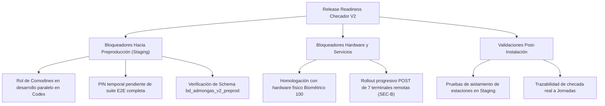

# CHECADOR V2 — RELEASE READINESS & DEPLOYMENT PREPARATION REPORT

**Versión del Documento:** V1.0  
**Fecha:** 2026-11-09  
**Proyectos Involucrados:** `Portal3`, `portal-api-v.1.0.1`, `Lector Windows`  
**Estado de Despliegue:** `PREPRODUCTION_READINESS: BLOCKED` | `PRODUCTION_READINESS: BLOCKED`  
**Objetivo:** Consolidar la auditoría funcional de Configuración de Checador V2 (M11), inventario técnico de despliegue, clasificación de bloqueadores reales y protocolo de despliegue/rollback previo al pase a preproducción.

---

## 1. RESUMEN EJECUTIVO Y ESTADO DE PREPARACIÓN

Checador V2 ha completado la fase de consolidación técnica en desarrollo local de la pantalla de **Configuración (M11)**, alineándola estrictamente con el contrato arquitectónico inmutable (`CHECADOR_V2_ARCHITECTURE_FREEZE_V1.0.md`) y el addendum de gobernanza (`CHECADOR_V2_M11_COMPLETE_CONFIGURATION_ADDENDUM_V1.0.md`).

Se ha verificado la separación completa de responsabilidades y alcances:
- **Encargado (Puesto 6):** Administra su estación física autorizada (Palo Solo numlista=1, id=2) y consulta las localidades dependientes asociadas (Autolavado numlista=10, id=9), rotando secretos del lector físico propio y editando políticas prospectivas locales.
- **Autolavado (id=9):** Opera con aislamiento funcional completo, presentando la referencia al lector compartido sin exponer edición de credenciales de la estación anfitriona (`shared_reader_edit_not_authorized`).
- **Dirección de Operaciones (Puesto 13):** Consulta de forma transversal todas las localidades autorizadas, administra el catálogo institucional de puestos de trabajo mediante modal nativo, y opera con perfil de solo lectura sobre credenciales de lectores físicos para salvaguardar la seguridad de hardware en estación.

> [!IMPORTANT]
> **ESTADO DE PREPRODUCCIÓN:** Actualmente clasificado como **BLOCKED**.
> No debe realizarse ningún despliegue hacia preproducción ni producción hasta que concluyan los desarrollos paralelos en curso (Rol de Comodines y PIN temporal) y se efectúen las pruebas de homologación con hardware físico.

---

## 2. REVISIÓN FUNCIONAL DE CONFIGURACIÓN (M11)

La revisión funcional de M11 se ejecutó exclusivamente sobre las secciones y contratos existentes sin alterar valores persistidos en producción ni esquemas de base de datos:

| Dominio de Configuración | Estado | Contrato y Comportamiento Verificado |
| :--- | :---: | :--- |
| **Perfil del Lector** | `PASS` | Encargado consulta y rota credenciales exclusivamente para su estación anfitriona (Palo Solo). Autolavado muestra referencia a lector compartido sin controles de edición. Dirección opera en solo lectura. Contraseñas y tokens nunca viajan en el HTML inicial ni respuestas AJAX. |
| **Puestos Autorizados** | `PASS` | Catálogo institucional administrado exclusivamente por Dirección de Operaciones (`#m11-position-modal`). Encargado tiene el módulo completamente omitido del DOM (`$canReadPositions = false`). Nombres duplicados activos son bloqueados en servidor. |
| **Retardos y Tolerancias**| `PASS` | Tolerancia (0 a 120 min) versionada de forma prospectiva e inmutable en `tb_checador_asistencia_politicas`. Modal unificado `#m11-policy-modal` con protección CSRF, validación Alpine/Axios y bloqueo de doble submit. |
| **Horarios y Descansos** | `PASS` | Reutilización canónica del enlace hacia M04 (`/departamento-operativo/recursos-humanos/checador/horarios-turnos`). No existe editor duplicado ni reglas paralelas en M11. |
| **Plazos de Incidencias** | `PASS` | Plazo límite de captura (1 a 30 días) configurado junto a la política de asistencia por localidad. Preserva vigencia histórica de jornadas evaluadas. |
| **Permisos y Alcance** | `PASS` | Autorización estricta en servidor según rol y estación. Prohibición de acceso directo del navegador al API (`BROWSER_DIRECT_API: NO`). Encargado restringido a sus localidades (`workplaces`). |
| **Validación Chrome E2E**| `PASS` | Suites Playwright ejecutadas en navegadores Chromium sobre perfiles reales (`encargado`, `encargado-palo-solo`, `direccion-operaciones`) a 375, 768 y 1440 px sin errores de consola ni mutaciones no autorizadas. |

---

## 3. INVENTARIO TÉCNICO DE DESPLIEGUE

### 3.1 Portal3 (`/home/silvinol/Proyectos/Portal3`)

- **Rutas Web (`routes/web.php`):**
  - `GET /departamento-operativo/recursos-humanos/checador` (Dashboard M00)
  - `GET /departamento-operativo/recursos-humanos/checador/asistencia-diaria` (M01 Asistencia Diaria)
  - `GET /departamento-operativo/recursos-humanos/checador/reporte-checador` (M02 Reporte Checador)
  - `GET /departamento-operativo/recursos-humanos/checador/programacion-semanal` (M03 Programación Semanal)
  - `GET /departamento-operativo/recursos-humanos/checador/horarios-turnos` (M04 Horarios y Turnos)
  - `GET /departamento-operativo/recursos-humanos/checador/jornadas-laborales` (M05 Jornadas persistidas)
  - `GET /departamento-operativo/recursos-humanos/checador/incidencias` (M06 Incidencias)
  - `GET /departamento-operativo/recursos-humanos/checador/ajustes-administrativos` (M07 Ajustes)
  - `GET /departamento-operativo/recursos-humanos/checador/comparacion-nomina` (Comparación Nómina)
  - `GET /departamento-operativo/recursos-humanos/checador/configuracion` (M11 Configuración)
  - `POST /departamento-operativo/recursos-humanos/checador/configuracion/politica` (Guardado Política)
  - `POST /departamento-operativo/recursos-humanos/checador/configuracion/lector-perfil` (Rotación Lector)
  - `POST /departamento-operativo/recursos-humanos/checador/configuracion/puestos` (Puestos Institucionales)
  - `GET /departamento-operativo/recursos-humanos/checador/configuracion/dispositivos/data` (Inventario)
- **Controladores Principales:**
  - `app/Controllers/ChecadorController.php`
  - `app/Controllers/RolComodinesController.php`
  - `app/Controllers/DptoOperativoController.php`
- **Servicios Clave:**
  - `app/Services/ChecadorConfigurationReadService.php`
  - `app/Services/ChecadorDailyReadService.php`
  - `app/Services/ChecadorWeeklyScheduleService.php`
  - `app/Services/ChecadorPayrollComparisonReadService.php`
  - `app/Services/ChecadorRawPunchReadService.php`
  - `app/Services/ChecadorAttendanceProjection.php`
  - `app/Services/ChecadorAttendanceRosterService.php`
  - `app/Services/ChecadorAccessService.php`
  - `app/Services/ModuleStationService.php`
- **Vistas PHP (`app/Views/departamento-operativo/2-recursos-humanos/checador/`):**
  - `index.php`, `configuration.php`, `daily-attendance.php`, `punch-report.php`, `schedule-week.php`, `schedule-history.php`, `workspace-journeys.php`, `workspace-incidences.php`, `workspace-adjustments.php`, `payroll-comparison.php`, `workspace-temporary-access.php`.
- **Assets Frontend:**
  - CSS: `public/assets/css/styles.css`, `public/assets/css/table-actions.css`, `public/assets/css/checador-*.css`.
  - JS: `public/assets/js/core/module-station-selector.js`, `public/assets/js/core/csrf-request-setup.js`, `public/assets/js/departamento-operativo/2-recursos-humanos/checador.*.init.js`.
- **Librerías y Dependencias:**
  - Bootstrap 5.3.x, Modernize UI Theme, Tabler Icons.
  - DataTables 1.13.5 (Bootstrap 5), Select2 4.0.13, Flatpickr, Alpine.js 3.x, Axios 1.x, jQuery 3.7.x.
- **Variables de Entorno (`.env`):**
  - `APP_ENV=preproduction`
  - `DB_HOST`, `DB_PORT`, `DB_DATABASE=bd_admongas_v2_preprod`, `DB_USERNAME`, `DB_PASSWORD`
  - `CHECADOR_API_URL=https://api.admongas.com.mx`
  - `CHECADOR_API_JWT_KEY`
- **Requisitos de Servidor:**
  - PHP 8.2+ (`pdo_mysql`, `curl`, `json`, `mbstring`, `openssl`, `session`).
  - Apache 2.4+ / Nginx con `mod_rewrite`, TLS 1.2+ obligatorio.

### 3.2 API V2 (`/home/silvinol/Proyectos/portal-api-v.1.0.1`)

- **Endpoints Oficiales:**
  - Ingesta de Checadas: `POST /api/v2/punch-events` (Autenticación Bearer token lector).
  - Telemetría de Dispositivos: `POST /api/v2/telemetry/heartbeat`, `POST /api/v2/telemetry/level2`.
  - Sincronización de Roster: `GET /api/v2/roster/sync/{workplace_id}`.
  - Políticas de Asistencia: `GET /api/v2/attendance-policy/{workplace_id}`, `POST /api/v2/attendance-policy` (JWT Portal3).
  - Jornadas e Incidencias: `GET /api/v2/journeys/evaluation`, `POST /api/v2/journeys/evaluate`, `GET /api/v2/incidences`, `POST /api/v2/incidences`.
  - PIN Temporal: `POST /api/v2/temporary-access/request`, `POST /api/v2/temporary-access/verify`.
- **Modelos y Servicios (`modelo/v2/`):**
  - Motores de evaluación de jornadas e incidencias, servicios de persistencia append-only, generador de roster, validadores criptográficos de contraseñas.
- **Esquema de Base de Datos:**
  - `bd_admongas_v2_preprod` (MariaDB 10.11+).
  - Tablas: `tb_checador_asistencia_politicas`, `tb_checador_lectores_perfiles`, `tb_checador_eventos_ingesta`, `tb_checador_jornadas`, `tb_checador_incidencias`, `tb_checador_auditoria`.
- **Variables de Entorno (`.env`):**
  - `CHECADOR_DEPLOYMENT_PROFILE=preproduction`
  - `DB_HOST`, `DB_NAME=bd_admongas_v2_preprod`, `DB_USER`, `DB_PASSWORD`
  - `JWT_SECRET`
  - `RATE_LIMIT_PUNCH_RPS=20`, `RATE_LIMIT_PUNCH_BURST=60`
  - `RATE_LIMIT_AUTH_RPS=5`, `RATE_LIMIT_AUTH_BURST=15`

### 3.3 Lector Windows (Componente Independiente)

- **Binarios y Bibliotecas:**
  - Daemon de servicio Windows `AdmonGasChecador.exe`.
  - SDK de captura biométrica / ZKTeco (`zkemkeeper.dll`, `plcommpro.dll` o SDK nativo del lector).
- **Configuración de Dispositivo (`appsettings.json`):**
  - `StationId` / `WorkplaceId` (ej. 2 para Palo Solo).
  - `ApiEndpoint` (`https://api.admongas.com.mx/api/v2`).
  - `DeviceKey` / `ClientSecret` (hash bcrypt autenticado contra el API).
  - `BiometricDeviceIp` / `Port` (IP LAN del hardware, ej. `192.168.1.201:4370`).
- **Certificados y TLS:**
  - Certificado raíz de confianza en Windows Trust Store para conexión HTTPS estricta a `api.admongas.com.mx`.
- **Almacén Offline de Respaldo:**
  - Base de datos SQLite local incrustada (`offline_buffer.db`) para almacenar eventos no confirmados en caso de interrupción de red.
  - Purga de eventos confirmados tras 30 días.
- **Políticas de Reintento y Heartbeat:**
  - Reintento con backoff exponencial (1s, 5s, 15s, 60s, max 300s).
  - Daemon de telemetría periódica cada 60s.

---

## 4. CLASIFICACIÓN DE BLOQUEADORES REALES



### 4.1 Bloqueadores Hacia Preproducción (Staging)
1. **Rol de Comodines en desarrollo paralelo:**
   - La funcionalidad de asignación y programación de comodines está siendo implementada activamente en paralelo en Codex. Debe concluirse y congelarse antes de empaquetar staging.
2. **PIN Temporal pendiente de E2E completo:**
   - El flujo de solicitud y verificación de PIN temporal debe superar la validación E2E completa antes de liberar el código.
3. **Verificación de Schema en Servidor de Preproducción:**
   - Confirmar que la base de datos remota `bd_admongas_v2_preprod` en `82e9a5d.online-server.cloud` contenga las tablas actualizadas sin divergencia estructural.

### 4.2 Bloqueadores de Servicios Conectados y Hardware Físico
1. **Validación con hardware físico del lector conectado:**
   - Comprobar la ingesta en vivo desde el dispositivo físico Biométrico 100 de Palo Solo y terminales piloto conectadas.
2. **Rollout de terminales remotas (Decisión SEC-B):**
   - Transicionar de forma controlada las 7 terminales físicas de GET a POST tras verificar preproducción.

### 4.3 Validaciones Post-Instalación en Staging
1. Verificación de aislamiento estricto entre estaciones (ej. Encargado de Palo Solo no debe acceder a Interlomas).
2. Trazabilidad de una checada de prueba: ingesta -> persistencia en eventos -> cómputo de jornada en M05 -> reflejo en reporte M02.
3. Confirmación de políticas versionadas de tolerancia y retardos.

### 4.4 Mejoras Opcionales (No Bloqueantes)
- Afinación cosmética de micro-espaciado en vistas móviles de resolución extrema (< 360px).
- Revisión de telemetría de tasa de consumo antes de Cutover productivo definitivo.

---

## 5. PLAN DE DESPLIEGUE Y ROLLBACK

### 5.1 Verificaciones Previas (Preflight Checks)
1. Comprobar conectividad SSH y certificados TLS válidos en `api.admongas.com.mx` y `preprod-portal.admongas.com.mx`.
2. Verificar espacio en disco y permisos de escritura en los directorios de logs y caché.
3. Confirmar que la base de datos `bd_admongas_v2_preprod` esté accesible y aislada de producción.
4. Ejecutar suites de regresión sintéticas locales (`php tests/checador_m11_complete_configuration_regression.php` y quality gates de UI).

### 5.2 Procedimiento de Respaldo (Backup)
1. **Respaldo de Base de Datos:**
   ```bash
   mysqldump --single-transaction --routines --triggers -h [DB_HOST] -u [DB_USER] -p bd_admongas_v2_preprod > backup_preprod_$(date +%Y%m%d_%H%M%S).sql
   ```
2. **Respaldo de Código Runtime:**
   ```bash
   tar -czf backup_portal3_preprod_$(date +%Y%m%d_%H%M%S).tar.gz /ruta/a/portal3
   tar -czf backup_api_preprod_$(date +%Y%m%d_%H%M%S).tar.gz /ruta/a/portal-api
   ```

### 5.3 Secuencia Canónica de Despliegue
1. **Paso 1 — Migraciones de Esquema:**
   - Ejecutar scripts DDL idempotentes en `bd_admongas_v2_preprod`.
   - Verificar integridad referencial e índices de `tb_checador_*`.
2. **Paso 2 — Despliegue de API V2:**
   - Desplegar código del repositorio `portal-api-v.1.0.1`.
   - Asegurar `.env` con perfil `CHECADOR_DEPLOYMENT_PROFILE=preproduction`.
   - Reiniciar PHP-FPM y validar endpoint de salud (`GET /api/v2/telemetry/heartbeat`).
3. **Paso 3 — Despliegue de Portal3:**
   - Desplegar código de `Portal3`.
   - Limpiar OPcache y cachés de vistas.
   - Verificar carga de rutas de Checador V2.
4. **Paso 4 — Configuración de Terminal de Prueba:**
   - Configurar lector de prueba hacia `https://api.admongas.com.mx/api/v2`.
   - Ejecutar checada de prueba controlada.

### 5.4 Pruebas de Humo (Smoke Testing)
- Acceso a `/departamento-operativo/recursos-humanos/checador` con perfil Encargado y Dirección.
- Consulta de `/departamento-operativo/recursos-humanos/checador/configuracion`: verificar que Encargado ve su estación y Dirección ve catálogo institucional.
- Validación de que Autolavado carga sin errores y no permite editar lector anfitrión.
- Envío de evento de prueba al API y verificación de respuesta JSON `{ "status": "OK" }`.

### 5.5 Procedimiento de Rollback
1. Si API V2 o Portal3 fallan en las pruebas de humo:
   - Restaurar inmediatamente los directorios de código a partir del tarball de respaldo.
   - Reiniciar PHP-FPM y servidor web.
2. Si hubo fallas a nivel de base de datos o corrupción de datos:
   - Restaurar el volcado SQL previo (`backup_preprod_*.sql`).
3. Reconfigurar lectores hacia el endpoint previo en caso de afectación.
4. Notificar formalmente al Project Owner y registrar el evento en el log de incidencias técnicas.

---

## 6. MATRIZ DE ESTADO FINAL

```text
CONFIG_READER: PASS
CONFIG_POSITIONS: PASS
CONFIG_LATENESS: PASS
CONFIG_SCHEDULES: PASS
CONFIG_INCIDENCES: PASS
CONFIG_PERMISSIONS: PASS
CONFIG_CHROME_E2E: PASS
PORTAL3_DEPLOYMENT_INVENTORY: READY
API_DEPLOYMENT_INVENTORY: READY
LECTOR_DEPLOYMENT_INVENTORY: READY
RELEASE_BLOCKERS: [Rol de Comodines en desarrollo paralelo, PIN temporal pendiente de E2E, Validación con hardware físico del lector conectado]
PREPRODUCTION_READINESS: BLOCKED
PRODUCTION_READINESS: BLOCKED
COMODINES_UNCHANGED: YES
OTHER_MODULES_UNCHANGED: YES
DATABASE_UNCHANGED: YES
```
